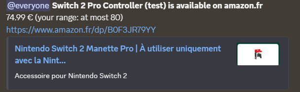
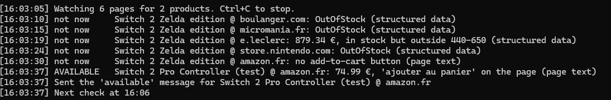

# restock-watch

Sends a Discord or phone notification when a product is back in stock at a normal price.

I wrote it to get the Switch 2 Zelda edition. It sold out everywhere within minutes, then showed up on
marketplaces at 900 €. You give it the product page of the same item in a few shops and the price you're
willing to pay. It checks those pages every few minutes and pings you as soon as one of them can be bought
in your range. The range is what keeps the resellers out.



It runs on Windows and only needs Edge, which Windows already has.

## How it works

For each page it reads the offers the shop publishes for search engines (schema.org data: price and
availability). Most big shops have them, and they're much more reliable than the page itself. When a page
has none, it falls back to the page text: a price in your range and an "add to cart" button.



It drives a real Edge window, with one tab per page. A lot of shops show a captcha to anything that looks
like a bot. When that happens, solve it by hand in its tab: cookies are kept in `browser_profile/`, so it
usually holds for a while.

You get:

- one alert when a page becomes available in your range, and another one if the price drops further
- a warning when a shop has shown its anti-bot page 5 times in a row
- a message when it starts, and when it stops because of an error

## Setup

1. Download the zip from the [Releases](../../releases) page and unzip it in a folder of its own.
   The browser profile grows to a few hundred MB.
2. Run `RestockWatch.exe`. The first time, it creates `config.json` next to itself and opens it in Notepad.
3. Put your product pages and your Discord webhook or ntfy topic in it (see below), save, and run it again.

Windows may say it protected your PC, because the exe isn't signed: click **More info**, then
**Run anyway**.

Leave the console and the Edge window open (you can minimize them), and keep the PC awake. To stop, close
the console.

Each round prints what was found on every page. Check the first round: a page that says `unknown` or
`BLOCKED` needs a look (see [Shops](#shops)).

## config.json

```json
{
  "discord_webhook": "https://discord.com/api/webhooks/...",
  "ntfy_topic": "",
  "minutes_between_checks": [2, 5],
  "products": [
    {
      "name": "Switch 2 Zelda edition",
      "min_price": 440,
      "max_price": 650,
      "urls": [
        "https://www.boulanger.com/ref/1250188",
        "https://www.micromania.fr/p/console-nintendo-switch-2-edition-limitee-40eme-anniversaire-the-legend-of-zelda-164787.html",
        { "url": "https://www.amazon.fr/dp/B0F2TN43GH", "selector": "#desktop_buybox" }
      ]
    },
    {
      "name": "Switch 2 Pro Controller",
      "max_price": 65,
      "urls": [
        { "url": "https://www.amazon.fr/dp/B0F3JR79YY", "selector": "#desktop_buybox" }
      ]
    }
  ]
}
```

The price range decides what you're waiting for:

| You set | You get an alert when |
| --- | --- |
| `min_price` and `max_price` | it's back in stock at a normal price (resellers are above `max_price`) |
| `max_price` only | the price drops to `max_price` or below |
| neither | it's back in stock, at any price |

Setting a `min_price` also helps on pages read from their text, where shipping costs and accessories
show prices too.

Each entry in `urls` is a link, or an object with these options:

| Option | What it's for |
| --- | --- |
| `url` | the product page |
| `shop` | the name shown in alerts, instead of the site name |
| `selector` | a CSS selector of the buy box, so the text search ignores the rest of the page |
| `in_stock_texts` | the "add to cart" text, if the shop uses something unusual |
| `out_of_stock_texts` | texts that mean out of stock on this shop, like `"currently unavailable"` |

Other settings: `browser` (`"msedge"` by default, `"chrome"` works too), `headless` (`true` hides the
window, but shops are more likely to block it), `locale` (like `"fr-FR"`, the language the shops see),
and `ntfy_server` if you run your own ntfy.

A typo in a setting name is an error, not something silently ignored: `max_prise` would otherwise mean
alerts at any price.

## Notifications

**Discord**: in your server, create a channel, then Channel settings, Integrations, Webhooks,
New Webhook, Copy Webhook URL, and paste it in `discord_webhook`. On your phone, set the channel's
notifications to all messages. Alerts mention @everyone, so use a server of your own.

**ntfy**: install the [ntfy](https://ntfy.sh) app, subscribe to a topic name nobody would guess
(like `restock-7f3k9q2m`), and put the same name in `ntfy_topic`. No account needed. Topics on ntfy.sh
are public, which is why the name should be hard to guess.

Both can be set at once. The webhook URL lets anyone post in your channel: don't share your
`config.json`.

## Shops

What I checked on the French shops, in November 2026:

| Shop | Read from |
| --- | --- |
| Boulanger, Micromania, E.Leclerc, Auchan, Nintendo Store, Materiel.net | structured data |
| Amazon | page text, with `"selector": "#desktop_buybox"` |
| Fnac | blocked: the page comes back empty |

To add a shop, add its product page and look at the first round:

- `(structured data)`: reliable, nothing to do.
- `(page text)`: check that the result matches the page. If the page shows other products, add a
  `selector` for the buy box.
- `BLOCKED`: solve the captcha in its tab. Some shops block anyway.

## What it doesn't do, on purpose

- **It never buys anything.** It only tells you. Bots that check out automatically are how the resellers
  got those consoles in the first place.
- **It doesn't search for a product by name.** Every shop has its own search page and its own anti-bot,
  and telling the right product from bundles and accessories in search results is unreliable. You paste
  the product pages you want.
- **It doesn't check every few seconds.** The default is a random wait of 2 to 5 minutes between rounds.
  Faster gets your IP blocked.

If you want more, [changedetection.io](https://changedetection.io) watches any page for changes, has
restock and price detection, and supports dozens of notification services. It's a server you run in
Docker or a paid service. restock-watch is smaller: one exe, one JSON file, and an Edge window where you
can solve a captcha yourself.

## Running from source

Python 3.11 or newer.

```
python -m venv .venv
.venv\Scripts\activate
pip install -r requirements.txt
python restock_watch.py --test
```

`--test` checks every page once, prints what it found and sends a test message, without alerts.

- `restock_watch.py`: the watch loop and the browser
- `detection.py`: reading prices and availability from a page
- `tracker.py`: deciding when a result is worth an alert
- `notify.py`: Discord and ntfy
- `config.py`: reading and checking `config.json`
- `extract_offers.js`: collects the schema.org offers in the page

Tests: `pip install pytest`, then `pytest`. The exe: `pip install pyinstaller`, then `python build.py 1.0.0`.
Pushing a `v*` tag builds it on GitHub Actions and publishes the release.
